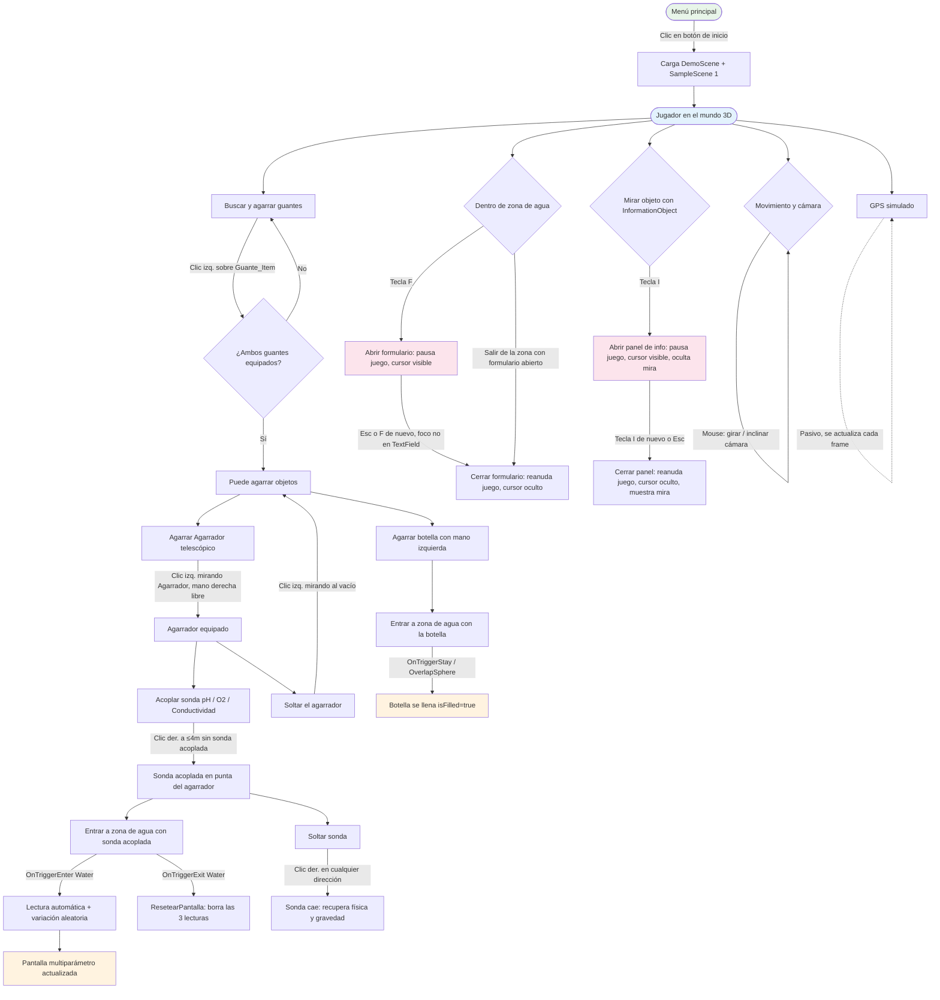

# Flujo de juego — Simulador de Biorremediación

## Notas del diagrama

- Las ramas de **formulario (F)** y **panel de información (I)** manejan `Time.timeScale` y el cursor de forma independiente, por lo que si se activan casi al mismo tiempo pueden pisarse entre sí (ver sección 8 y 10 del mapa funcional).
- El reseteo de pantalla multiparámetro al salir del agua borra **las tres lecturas**, no solo la de la sonda que salió.
- Agarrar objetos (sondas, botella, agarrador) requiere siempre tener **ambos guantes equipados** primero.