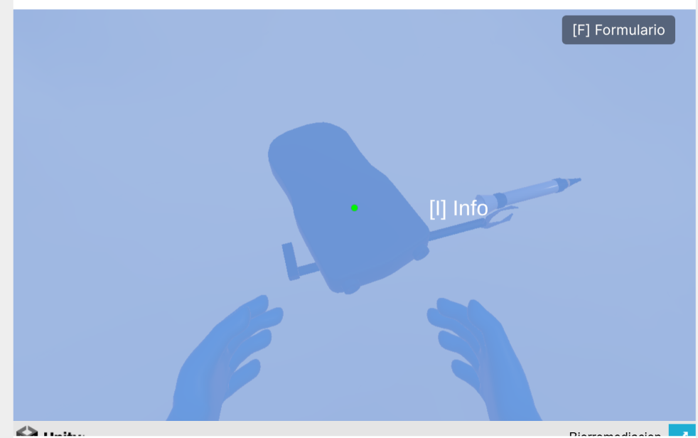
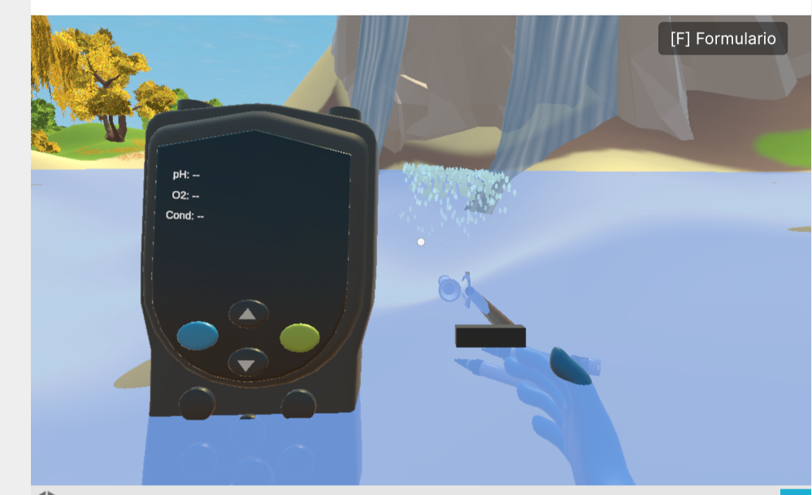
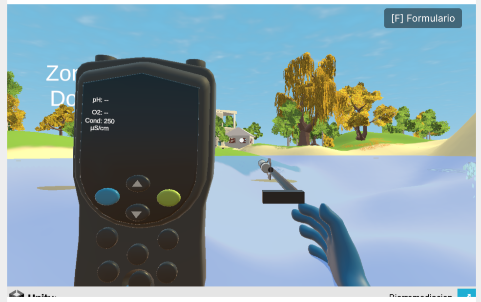
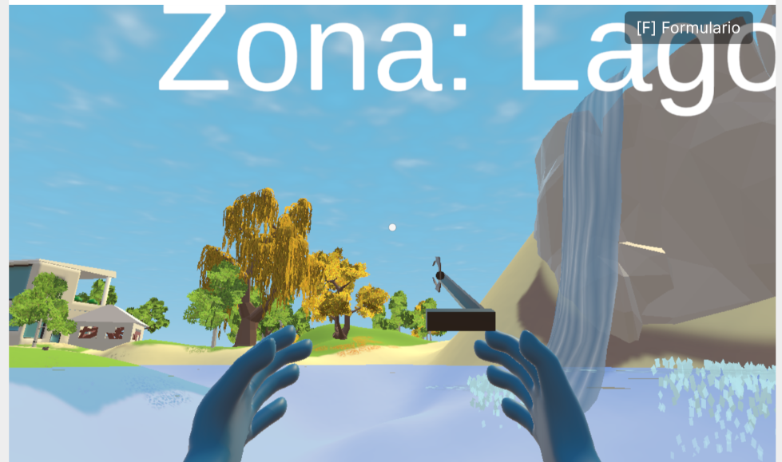
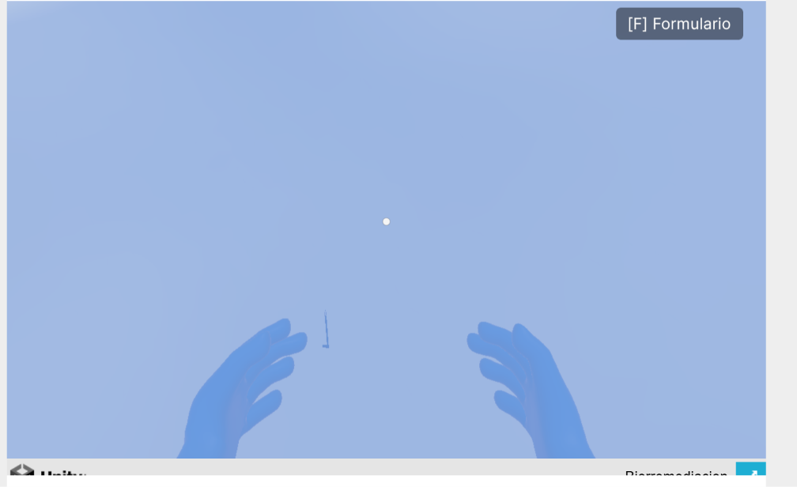

# Errores idntificados:

## 1. Se quitan los objetos cuando se pulsa [ESC] para salir del formulario:

### Pasos para recrear el error:

    1. Ponerse los guantes
    2. Click izquierdo en el agarrador
    3. click izquierdo en el multiparametro
    4. click derecho en alguna sonda
    5. ir a una zona de agua en los lugares ccorrectos
    5. pulsar [F] para ingresar al formulario
    6. pulsar [ESC] para salir del formulario

## 2. Se quitan los valores de la pantalla de multiparametro:

### Pasos para recrear el error:

    1. Se agarra dos o mas sondas y se las deja en un apartado de agua
    2. Agarrar una de las sondas puestas en el agua

## 3. Se queda pegado el numero si se deja el agarrador con la sonda en el agua:

### Pasos para recrear el error:

    1. Agarrar el agarrador telecopico
    2. Agarrar el multiparametro
    3. Agarrar una sondda (cualquiera de los 3)
    4. Ir a una zona de agua
    5. Click derecho para dejar el objeto del agarrador
    6. Volver a agarrar el objeto de agarrador telecopio

## 4. Se caen los objetos agarrador telescopico en la zona de agua al dejarlos caer desde una altura media alta:

### Pasos para recrear el error:

    1. Agarrar el agarrador telescopio
    2. ir a un lugar de zona de agua
    3. alzar un poco la camara del personaje hacia arriba
    4. pulsar click izquierdo para soltar el agarrador telescopico

